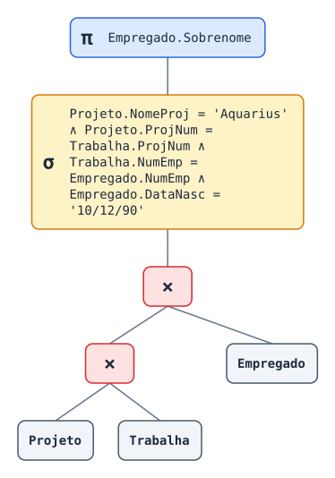
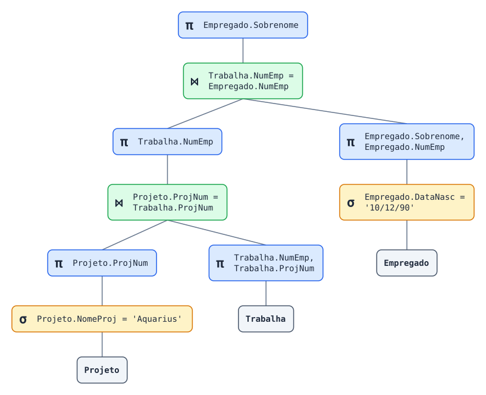

# Tradutor SQL → Álgebra Relacional com SLY

Este projeto traduz consultas `SELECT … FROM … WHERE …` (com `JOIN … ON`) para
expressões da Álgebra Relacional. O **lexer** e o **parser** são feitos com a
biblioteca [SLY](https://github.com/dabeaz/sly) (`sly.Lexer` / `sly.Parser`,
LALR(1)). A consulta inteira é analisada pela gramática; o código não usa
expressões regulares nem manipulação de texto para fazer a análise sintática.

```
SELECT nome, idade FROM alunos WHERE idade >= 18;
        ⟶   π_{nome, idade}(σ_{idade >= 18}(alunos))
```

Sumário:

1. [Fundamentos da gramática e da autoincorporação](#1-fundamentos-da-gramática-e-da-autoincorporação)
2. [Gramática formal completa](#2-gramática-formal-completa)
3. [Precedência e ações semânticas](#3-precedência-e-ações-semânticas)
4. [Código Python](#4-código-python)
5. [Instalação e execução](#5-instalação-e-execução)
6. [Exemplos, derivações e testes](#6-exemplos-derivações-e-testes)
7. [Limitações e melhorias possíveis](#7-limitações-e-melhorias-possíveis)

---

## 1. Fundamentos da gramática e da autoincorporação

### 1.1 As três fases de análise

| Fase | Arquivo | Entrada → Saída | O que verifica |
|---|---|---|---|
| Léxica | [sql_ar/lexer.py](sql_ar/lexer.py) | texto → sequência de *tokens* | se cada trecho do texto forma um token válido (palavra-chave, identificador, número, texto, operador) |
| Sintática | [sql_ar/parser.py](sql_ar/parser.py) | tokens → AST ([sql_ar/ast_sql.py](sql_ar/ast_sql.py)) | se a sequência de tokens pertence à linguagem gerada pela gramática |
| Semântica | [sql_ar/semantica.py](sql_ar/semantica.py) | AST → AST validada | se os nomes usados fazem sentido: tabelas repetidas, qualificadores (`x.col`) inexistentes, uso do nome original depois de um apelido, tabelas visíveis no `ON` |
| Tradução | [sql_ar/algebra.py](sql_ar/algebra.py) | AST → árvore relacional → texto | — |

A análise léxica é feita com expressões regulares, como é próprio dessa fase:
cada token é definido por um padrão. A estrutura da consulta (listas, aninhamento,
precedência) é tratada só pela gramática livre de contexto, porque linguagens com
parênteses aninhados **não são regulares**.

### 1.2 Recursão gramatical e autoincorporação

Um não terminal `A` é **recursivo** quando `A ⇒⁺ α A β`. Há três casos:

| Forma | Nome | Exemplo nesta gramática |
|---|---|---|
| `A ⇒⁺ A β` | recursão à esquerda | `lista_colunas → lista_colunas , coluna` |
| `A ⇒⁺ α A` | recursão à direita | `fator → NOT fator` |
| `A ⇒⁺ α A β`, com α ≠ ε e β ≠ ε | **autoincorporação** (*self-embedding*) em sentido estrito | `condicao ⇒⁺ ( condicao )` |

> **Observação sobre o termo.** Em muitos materiais didáticos, "autoincorporação"
> é usado para qualquer regra em que o não terminal aparece no próprio lado
> direito, e é nesse sentido que o enunciado o aplica a `lista_colunas`.
> Na teoria de linguagens formais (Chomsky), *self-embedding* exige símbolos dos
> dois lados (α e β não vazios). Isso importa porque uma gramática **sem**
> autoincorporação estrita gera apenas linguagens regulares. Listas separadas por
> vírgula são regulares (`coluna (, coluna)*`). Parênteses balanceados não são.
> Nesta gramática, a autoincorporação estrita aparece em
> `condicao → conjuncao → fator → ( condicao )`.
> As duas formas de recursão estão no código e são explicadas abaixo.

### 1.3 A lista de colunas recursiva à esquerda

```
lista_colunas → lista_colunas , coluna      (caso recursivo)
              | coluna                      (caso-base)
```

* **Caso-base** (`lista_colunas → coluna`): uma lista com uma única coluna.
  É ele que encerra a recursão. Sem essa regra, `lista_colunas` não derivaria
  nenhuma sentença.
* **Caso recursivo** (`lista_colunas → lista_colunas , coluna`): uma lista é uma
  lista menor seguida de `,` e mais uma coluna. O não terminal aparece na
  **primeira** posição do lado direito, por isso a recursão é **à esquerda**.
* **Tamanho variável**: aplicando o caso recursivo *n − 1* vezes e o caso-base
  uma vez, obtemos `coluna , coluna , … , coluna` com *n* colunas, para
  qualquer *n ≥ 1*. A linguagem gerada é `coluna (, coluna)*`.

**Por que preservar a recursão à esquerda no SLY?** O SLY gera um parser
**LR** (ascendente). A recursão à esquerda é a forma natural para parsers LR:

* a pilha não cresce com o tamanho da lista, porque cada `, coluna` é reduzido
  assim que lido;
* a lista é montada **da esquerda para a direita**, na ordem do texto. A ação
  semântica só faz `append`.

(Num parser descendente recursivo LL, a recursão à esquerda causaria laço
infinito e precisaria ser eliminada. Aqui ela não é um problema.)

Derivação mais à direita de `nome , idade , curso`:

```
lista_colunas
⇒ lista_colunas , coluna                       (recursivo)
⇒ lista_colunas , curso
⇒ lista_colunas , coluna , curso               (recursivo)
⇒ lista_colunas , idade , curso
⇒ coluna , idade , curso                       (caso-base)
⇒ nome , idade , curso
```

Árvore resultante, inclinada para a esquerda:

```
            lista_colunas
           /      |      \
   lista_colunas  ,     coluna(curso)
    /    |    \
lista_col ,  coluna(idade)
   |
coluna(nome)
```

O parser LR executa essa derivação **ao contrário** (reduções):
`nome` → `coluna` → `lista_colunas` (caso-base, lista = `[nome]`), depois
`lista_colunas , idade` → `lista_colunas` (lista = `[nome, idade]`), depois
`lista_colunas , curso` → `lista_colunas` (lista = `[nome, idade, curso]`).

As produções recursivas aparecem no código SLY marcadas com `[RECURSIVA]`:

```python
# [RECURSIVA à esquerda] caso recursivo
@_('lista_colunas COMMA coluna')
def lista_colunas(self, p):
    self._registrar(p)
    p.lista_colunas.append(p.coluna)
    return p.lista_colunas

# Caso-base: uma única coluna inicia a lista
@_('coluna')
def lista_colunas(self, p):
    self._registrar(p)
    return [p.coluna]
```

Outras produções recursivas: `lista_tabelas` (mesma estrutura),
`item_from` (`JOIN` encadeado), `condicao` (`OR`), `conjuncao` (`AND`),
`fator → NOT fator` (à direita) e `fator → ( condicao )` (autoincorporação).

---

## 2. Gramática formal completa

**Símbolo inicial:** `consulta`

**Terminais** (tokens do lexer):

| Token | Lexema |
|---|---|
| `SELECT FROM WHERE AND OR NOT JOIN INNER ON AS` | palavras-chave, sem diferença entre maiúsculas e minúsculas |
| `ID` | `[A-Za-z_][A-Za-z0-9_]*` (exceto palavras-chave) |
| `NUMBER` | `\d+(\.\d+)?` |
| `STRING` | `'…'` (aspas internas escritas como `''`) |
| `COMMA DOT STAR SEMI LPAREN RPAREN` | `,` `.` `*` `;` `(` `)` |
| `EQ NE LT GT LE GE` | `=` `!=`/`<>` `<` `>` `<=` `>=` |

Ignorados pelo lexer: espaços, tabulações, quebras de linha (contadas para as
mensagens de erro) e comentários `-- …`.

**Não terminais:** `consulta, fim, clausula_where, lista_selecao, lista_colunas,
coluna, referencia, lista_tabelas, item_from, tabela, condicao, conjuncao, fator,
comparacao, op_rel, operando`

**Produções (BNF):**

```bnf
consulta       → SELECT lista_selecao FROM lista_tabelas clausula_where fim

fim            → SEMI
               | ε

clausula_where → WHERE condicao
               | ε

lista_selecao  → STAR
               | lista_colunas

lista_colunas  → lista_colunas COMMA coluna        (* recursiva à esquerda *)
               | coluna

coluna         → referencia

referencia     → ID
               | ID DOT ID                         (* identificador qualificado *)

lista_tabelas  → lista_tabelas COMMA item_from     (* recursiva à esquerda *)
               | item_from

item_from      → item_from JOIN tabela ON condicao         (* recursiva à esquerda *)
               | item_from INNER JOIN tabela ON condicao
               | tabela

tabela         → ID
               | ID ID                             (* apelido *)
               | ID AS ID

condicao       → condicao OR conjuncao             (* nível 1: OR *)
               | conjuncao

conjuncao      → conjuncao AND fator               (* nível 2: AND *)
               | fator

fator          → NOT fator                         (* nível 3: NOT, recursiva à direita *)
               | LPAREN condicao RPAREN            (* autoincorporação *)
               | comparacao

comparacao     → operando op_rel operando

op_rel         → EQ | NE | LT | GT | LE | GE

operando       → referencia | NUMBER | STRING
```

A mesma gramática em EBNF, só como referência (o SLY recebe a forma BNF acima):

```ebnf
consulta   = "SELECT" ( "*" | coluna { "," coluna } ) "FROM" item_from { "," item_from }
             [ "WHERE" condicao ] [ ";" ] ;
item_from  = tabela { [ "INNER" ] "JOIN" tabela "ON" condicao } ;
tabela     = ID [ [ "AS" ] ID ] ;
condicao   = conjuncao { "OR" conjuncao } ;
conjuncao  = fator { "AND" fator } ;
fator      = "NOT" fator | "(" condicao ")" | operando op_rel operando ;
operando   = referencia | NUMBER | STRING ;
referencia = ID [ "." ID ] ;
```

O SLY gera para essa gramática uma tabela LALR(1) com **61 estados e nenhum
conflito** (shift/reduce = 0, reduce/reduce = 0), o que foi verificado por
`SqlParser._lrtable.sr_conflicts` / `rr_conflicts`. Logo, a gramática não é
ambígua para o SLY.

---

## 3. Precedência e ações semânticas

### 3.1 Precedência codificada na gramática

Em vez da tabela `precedence` do SLY (usada em [calc.py](calc.py)), a
precedência lógica é **estratificada em níveis**. Cada nível só pode conter
o nível seguinte:

```
condicao  (OR)   →  conjuncao (AND)  →  fator (NOT, parênteses, comparação)
```

Consequências:

* **AND precede OR.** Um `OR` só aparece em `condicao`. Para que ele fique
  dentro de um `AND`, é preciso voltar a `condicao` por
  `fator → ( condicao )`, ou seja, usando parênteses explícitos.
* **Associatividade à esquerda.** As regras `condicao → condicao OR conjuncao`
  e `conjuncao → conjuncao AND fator` são recursivas à esquerda, então
  `a OR b OR c` vira `(a OR b) OR c`.
* **Sem ambiguidade.** Cada sentença tem uma única árvore. O SLY confirma
  isso: não há conflitos.

Escolhi essa forma por ser a mais didática: a precedência fica visível nas
produções e nas árvores de derivação. Com a tabela `precedence` o resultado
seria o mesmo, mas a gramática seria ambígua e o desempate ficaria escondido
no gerador do parser.

Exemplo: `a = 1 OR b = 2 AND c = 3` (árvore real impressa por `--arvore`,
resumida):

```
condicao
├── condicao ── conjuncao ── fator ── comparacao (a = 1)
├── "OR"
└── conjuncao
    ├── conjuncao ── fator ── comparacao (b = 2)
    ├── "AND"
    └── fator ── comparacao (c = 3)
```

O `AND` fica **mais fundo** na árvore, então é agrupado primeiro:
`a = 1 ∨ (b = 2 ∧ c = 3)`. Com `(a = 1 OR b = 2) AND c = 3`, a raiz passa a
ser `conjuncao` e o `OR` fica dentro de `fator → ( condicao )`.

### 3.2 Ações semânticas e estruturas intermediárias

Cada produção tem uma ação Python que devolve um nó da **AST** (dataclasses
imutáveis em [sql_ar/ast_sql.py](sql_ar/ast_sql.py)). Nenhuma ação monta
strings de Álgebra Relacional.

| Produção | Ação semântica (valor sintetizado) |
|---|---|
| `referencia → ID DOT ID` | `Coluna(nome=ID₁, tabela=ID₀)` |
| `lista_colunas → coluna` | `[coluna]` |
| `lista_colunas → lista_colunas , coluna` | `lista.append(coluna)` |
| `lista_selecao → *` | `None` (sem projeção) |
| `tabela → ID AS ID` | `Tabela(nome, apelido)` |
| `item_from → item_from JOIN tabela ON condicao` | `Join(esq, dir, condicao)` |
| `condicao → condicao OR conjuncao` | `Ou(esq, dir)` |
| `conjuncao → conjuncao AND fator` | `E(esq, dir)` |
| `fator → NOT fator` | `Nao(fator)` |
| `fator → ( condicao )` | `condicao` (o agrupamento já está na árvore) |
| `comparacao → operando op_rel operando` | `Comparacao(esq, op, dir)` |
| `consulta → …` | `Consulta(colunas, origem, where)` |

São atributos **sintetizados**: cada valor vem dos filhos, como numa
gramática S-atribuída, que é o modelo natural de um parser ascendente.

Toda ação chama também `self._registrar(p)`. Esse método usa
`self.production` (definido pelo SLY antes de cada redução) para anotar a
produção aplicada. A partir dessas anotações, [sql_ar/derivacao.py](sql_ar/derivacao.py)
reconstrói a **derivação mais à direita** (as reduções em ordem inversa) e a
**árvore sintática**.

### 3.3 Tradução para a Álgebra Relacional

[sql_ar/algebra.py](sql_ar/algebra.py) converte a AST numa árvore de operadores
(`Relacao`, `Renomeacao`, `Selecao`, `Projecao`, `ProdutoCartesiano`,
`Juncao`) seguindo a forma canônica:

```
SELECT L FROM R₁, …, Rₙ WHERE C   ⟶   π_{L}( σ_{C}( R₁ × … × Rₙ ) )
```

| SQL | Álgebra Relacional |
|---|---|
| `FROM R₁, R₂, R₃` | `R₁ × R₂ × R₃`, que equivale a `(R₁ × R₂) × R₃` |
| `R JOIN S ON c` | `R ⋈_{c} S` (junção theta) |
| `alunos a` / `alunos AS a` | `ρ_{a}(alunos)` |
| `WHERE C` | `σ_{C}(…)` |
| `SELECT L` | `π_{L}(…)` |
| `SELECT *` | sem `π` |
| `AND` / `OR` / `NOT` | `∧` / `∨` / `¬` |

A formatação usa parênteses **mínimos que preservam a estrutura**: um `∨`
dentro de um `∧` recebe parênteses. Um operador do mesmo nível à direita,
que só existe se o usuário escreveu parênteses (ex.: `a OR (b OR c)`),
também os mantém. Na álgebra, `×` é associativo e é escrito sem parênteses.
Junções encadeadas são parentizadas: `(a ⋈ b) ⋈ c`.

Por padrão, a tradução **não** transforma `σ_{R.a = S.b}(R × S)` em `R ⋈ S`: a
saída reflete a consulta como foi escrita. A opção `--otimizar` mostra também a
versão otimizada (seção 6.6).

---

## 4. Código Python

O código está completo e é executável. Fica no pacote `sql_ar/`:

| Arquivo | Conteúdo |
|---|---|
| [sql_ar/lexer.py](sql_ar/lexer.py) | `SqlLexer(sly.Lexer)`: tokens, palavras-chave case-insensitive, strings, números, comentários, contagem de linhas e `error()` para caracteres inválidos e strings não fechadas |
| [sql_ar/parser.py](sql_ar/parser.py) | `SqlParser(sly.Parser)`: todas as produções da seção 2 com ações semânticas e `error()` que lista os tokens esperados |
| [sql_ar/ast_sql.py](sql_ar/ast_sql.py) | nós da AST SQL |
| [sql_ar/semantica.py](sql_ar/semantica.py) | análise semântica (escopo de tabelas e apelidos) |
| [sql_ar/algebra.py](sql_ar/algebra.py) | nós da Álgebra Relacional, tradução e formatação (linear e em árvore) |
| [sql_ar/otimizador.py](sql_ar/otimizador.py) | otimização algébrica: seleções e projeções descem na árvore |
| [sql_ar/grafo.py](sql_ar/grafo.py) | árvore de consulta como grafo em SVG, só com a biblioteca padrão |
| [sql_ar/derivacao.py](sql_ar/derivacao.py) | derivação mais à direita e árvore sintática a partir das reduções |
| [sql_ar/erros.py](sql_ar/erros.py) | `ErroLexico`, `ErroSintatico`, `ErroSemantico` com linha, coluna e destaque `^` |
| [sql_ar/tradutor.py](sql_ar/tradutor.py) | `traduzir(sql)`: encadeia as fases |
| [main.py](main.py) | interface de linha de comando e modo interativo |
| [tests/test_tradutor.py](tests/test_tradutor.py) | testes `unittest` do tradutor e do grafo |
| [tests/test_otimizador.py](tests/test_otimizador.py) | testes do otimizador, incluindo a equivalência entre as árvores |

Uso como biblioteca:

```python
from sql_ar import traduzir, ErroTraducao

try:
    r = traduzir("SELECT nome FROM alunos WHERE idade >= 18;")
    print(r.texto)              # π_{nome}(σ_{idade >= 18}(alunos))
    print(r.arvore_algebra())   # árvore de operadores
    print(r.derivacao())        # derivação mais à direita
except ErroTraducao as e:
    print(e.destacar(sql))
```

### Pontos de compatibilidade com a API real do SLY 0.5 (revisados)

* `tokens = { … }` com nomes não definidos e `@_(…)` dentro da classe são
  resolvidos pela metaclasse do SLY. Os linters podem acusá-los como nomes
  indefinidos, mas eles funcionam.
* Os padrões de tokens são testados **na ordem de definição**. Por isso `<=`,
  `>=` e `!=|<>` vêm antes de `<`, `>` e `=`.
* Palavras-chave são reconhecidas na função `ID`, que troca `t.type`
  (comparando em maiúsculas). O mecanismo `ID['select'] = SELECT` do SLY
  diferencia maiúsculas de minúsculas e não serviria.
* Produções vazias são escritas como `@_('')`. Várias alternativas cabem num
  mesmo decorador: `@_('EQ', 'NE', …)`.
* Símbolos repetidos são acessados como `p.ID0`/`p.ID1` e `p.operando0`/`p.operando1`.
* `start = 'consulta'` define o símbolo inicial.
* **Armadilha encontrada:** durante `parse()`, o SLY substitui `self.tokens`
  pelo gerador de tokens. Por isso o parser consulta `SqlLexer.tokens`, e não
  `self.tokens`, para saber se um símbolo é terminal.
* `error()` lança exceção, então não há recuperação de erro: a análise para
  no primeiro erro. A lista de tokens esperados usa `_lrtable` e
  `statestack`, que são internos do SLY. O código está protegido: se esses
  atributos mudarem, só a lista some da mensagem.

---

## 5. Instalação e execução

Testado com Python 3.14.7 e 3.15.0 e SLY 0.5, no Windows. Outras versões não foram testadas.

### 5.1 Instalação

Abra o terminal na **pasta do projeto** (a que contém `main.py`). Todos os comandos
desta seção partem dela.

Crie um ambiente virtual (opcional, mas evita misturar dependências):

```bash
python -m venv .venv
```

Ative o ambiente no PowerShell:

```powershell
.venv\Scripts\Activate.ps1
```

Ou, no Git Bash:

```bash
source .venv/Scripts/activate
```

Instale a dependência:

```bash
python -m pip install -r requirements.txt
```

Se o terminal não reconhecer `python`, use `py` no lugar. Se o PowerShell bloquear a
ativação, rode antes `Set-ExecutionPolicy -Scope Process RemoteSigned`, que vale só
para aquela janela.

Para conferir, rode os testes. A última linha deve ser `OK`:

```bash
python -m unittest
```

### 5.2 Traduzir uma consulta

```bash
python main.py "SELECT nome, idade FROM alunos WHERE idade >= 18;"
```

Saída:

```
SQL: SELECT nome, idade FROM alunos WHERE idade >= 18;
AR:  π_{nome, idade}(σ_{idade >= 18}(alunos))
```

**Coloque a consulta entre aspas duplas.** Sem elas, o terminal divide a consulta em
vários argumentos. Os textos do SQL continuam com aspas simples:

```bash
python main.py "SELECT nome FROM alunos WHERE curso = 'Física';"
```

### 5.3 Opções

As opções podem vir antes ou depois da consulta e podem ser combinadas.
`python main.py --help` mostra esta mesma lista.

| Opção | O que faz |
|---|---|
| `-f ARQUIVO`, `--arquivo ARQUIVO` | lê as consultas de um arquivo (seção 5.5) |
| `--exemplos` | roda as consultas de exemplo. A última é inválida de propósito, para mostrar a mensagem de erro |
| `--tokens` | mostra os tokens reconhecidos pelo lexer |
| `--arvore` | mostra a árvore relacional e a árvore sintática como texto |
| `--derivacao` | mostra a derivação mais à direita |
| `--otimizar` | mostra também a expressão otimizada (seção 6.6) |
| `--grafo ARQUIVO.svg` | salva a árvore de consulta como grafo |
| `--abrir` | abre o grafo no navegador. Sem `--grafo`, salva em `arvore_consulta.svg` |

Mostrar a derivação e as árvores:

```bash
python main.py --derivacao --arvore "SELECT nome, idade, curso FROM alunos;"
```

Gerar o grafo e abrir no navegador (seção 6.5):

```bash
python main.py "SELECT nome FROM alunos WHERE idade >= 18;" --grafo arvore.svg --abrir
```

Comparar as árvores canônica e otimizada. Este comando salva dois arquivos,
`arvore.svg` e `arvore_otimizada.svg`:

```bash
python main.py "SELECT a.nome FROM alunos a, matriculas m WHERE a.id = m.aluno_id AND m.nota > 7;" --otimizar --grafo arvore.svg
```

Os grafos são salvos na pasta atual, e um arquivo com o mesmo nome é substituído.
Os arquivos `arvore*.svg` da raiz do projeto são ignorados pelo Git.

### 5.4 Modo interativo

```bash
python main.py
```

A consulta pode ocupar várias linhas e termina com `;` ou com uma linha vazia. Os comandos
começam com `:` e, com exceção de `:exemplos` e `:sair`, ligam ou desligam uma opção,
que continua valendo para as consultas seguintes.

| Comando | O que faz |
|---|---|
| `:tokens`, `:arvore`, `:derivacao`, `:otimizar` | ligam ou desligam a opção de mesmo nome |
| `:grafo` | liga ou desliga o grafo, salvo sempre em `arvore_consulta.svg` |
| `:exemplos` | roda as consultas de exemplo |
| `:sair` | encerra (`Ctrl+C` também) |

Exemplo de sessão:

```
sql> :otimizar
otimizar: ligado
sql> SELECT a.nome
...> FROM alunos a, matriculas m
...> WHERE a.id = m.aluno_id;

SQL: SELECT a.nome FROM alunos a, matriculas m WHERE a.id = m.aluno_id;
AR:  π_{a.nome}(σ_{a.id = m.aluno_id}(ρ_{a}(alunos) × ρ_{m}(matriculas)))
AR otimizada: π_{a.nome}(π_{a.nome, a.id}(ρ_{a}(alunos)) ⋈_{a.id = m.aluno_id} π_{m.aluno_id}(ρ_{m}(matriculas)))
sql> :sair
```

### 5.5 Consultas em arquivo

```bash
python main.py -f consultas.sql
```

O arquivo deve estar em UTF-8, e cada consulta deve **terminar em `;` no fim de uma linha**:

```sql
SELECT nome
FROM alunos;

SELECT idade FROM alunos WHERE idade > 1;
```

Duas consultas na mesma linha são lidas como uma só e geram erro de sintaxe.
Com `--grafo`, cada consulta gera um arquivo numerado: `arvore_1.svg`, `arvore_2.svg` etc.

### 5.6 Exemplos e testes

Rodar as consultas de exemplo (a última termina em erro de propósito):

```bash
python main.py --exemplos
```

Rodar os testes mostrando cada um. Execute este comando a partir da pasta do projeto:

```bash
python -m unittest -v
```

---

## 6. Exemplos, derivações e testes

As saídas abaixo foram **obtidas executando o programa** (`python main.py
--exemplos`) e os oito casos estão automatizados em
[tests/test_tradutor.py](tests/test_tradutor.py) (classe `TestesObrigatorios`).
Resultado: `Ran 59 tests … OK`.

### 6.1 Testes obrigatórios

**1. Uma coluna**
```
SELECT nome FROM alunos;
π_{nome}(alunos)
```

**2. Múltiplas colunas**
```
SELECT nome, idade, curso FROM alunos;
π_{nome, idade, curso}(alunos)
```

**3. WHERE com uma condição**
```
SELECT nome, idade FROM alunos WHERE idade >= 18;
π_{nome, idade}(σ_{idade >= 18}(alunos))
```

**4. Condições com AND**
```
SELECT nome FROM alunos WHERE idade >= 18 AND curso = 'Computação';
π_{nome}(σ_{idade >= 18 ∧ curso = 'Computação'}(alunos))
```

**5. OR com parênteses**
```
SELECT nome FROM alunos WHERE (curso = 'Computação' OR curso = 'Física') AND idade < 30;
π_{nome}(σ_{(curso = 'Computação' ∨ curso = 'Física') ∧ idade < 30}(alunos))
```
Sem os parênteses, `curso = 'Computação' OR curso = 'Física' AND idade < 30`
seria agrupado como `curso = 'Computação' ∨ (curso = 'Física' ∧ idade < 30)`.

**6. Duas tabelas: produto cartesiano + condição de junção**
```
SELECT alunos.nome, matriculas.disciplina FROM alunos, matriculas
WHERE alunos.id = matriculas.aluno_id;
π_{alunos.nome, matriculas.disciplina}(σ_{alunos.id = matriculas.aluno_id}(alunos × matriculas))
```

**7. JOIN … ON** (com apelidos, gerando ρ)
```
SELECT a.nome, m.nota FROM alunos a JOIN matriculas m ON a.id = m.aluno_id WHERE m.nota > 7;
π_{a.nome, m.nota}(σ_{m.nota > 7}(ρ_{a}(alunos) ⋈_{a.id = m.aluno_id} ρ_{m}(matriculas)))
```
Árvore de operadores (`--arvore`):
```
π a.nome, m.nota
└── σ m.nota > 7
    └── ⋈ a.id = m.aluno_id
        ├── ρ a
        │   └── alunos
        └── ρ m
            └── matriculas
```

**8. Consulta sintaticamente inválida** (vírgula ausente)
```
SELECT nome idade FROM alunos;
Erro sintático (linha 1, coluna 13): token inesperado 'idade' (identificador); esperado: ',', '.', FROM
    SELECT nome idade FROM alunos;
                ^
```

### 6.2 Outros casos verificados

| Entrada | Saída |
|---|---|
| `SELECT * FROM a, b, c` | `a × b × c` |
| `SELECT x FROM a JOIN b ON a.i=b.i JOIN c ON b.j <> c.j, d` | `π_{x}(((a ⋈_{a.i = b.i} b) ⋈_{b.j <> c.j} c) × d)` |
| `SELECT x FROM alunos a1, alunos a2 WHERE a1.id != a2.id` | `π_{x}(σ_{a1.id != a2.id}(ρ_{a1}(alunos) × ρ_{a2}(alunos)))` |
| `select * from a where not (x = 1 or y = 2) or (z = 3 or w = 4)` | `σ_{¬(x = 1 ∨ y = 2) ∨ (z = 3 ∨ w = 4)}(a)` |
| `SELECT nome FROM alunos WHERE idade > 1 # x` | `Erro léxico (linha 1, coluna 41): caractere inválido '#'` |
| `SELECT nome FROM alunos WHERE nome = 'abc` | `Erro léxico (linha 1, coluna 38): texto entre aspas simples não foi fechado` |
| `SELECT nome, FROM t` | `Erro sintático (linha 1, coluna 14): token inesperado 'FROM' (FROM); esperado: identificador` |
| *(consulta vazia)* | `Erro sintático (linha 1, coluna 1): fim inesperado da consulta; esperado: SELECT` |
| `SELECT x FROM alunos, alunos` | `Erro semântico (…): a tabela 'alunos' aparece mais de uma vez no FROM; use apelidos diferentes …` |
| `SELECT alunos.nome FROM alunos a` | `Erro semântico (…): a tabela 'alunos' foi renomeada para 'a'; use 'a.nome'` |
| `SELECT x FROM a, b JOIN c ON a.k = c.k` | `Erro semântico (…): 'a.k' referencia a tabela 'a', que não está disponível neste ponto da consulta (tabelas visíveis: b, c)` |

### 6.3 Derivação passo a passo com três colunas

Saída real de `python main.py --derivacao "SELECT nome, idade, curso FROM alunos;"`.
Em cada passo o **não terminal mais à direita** é expandido, e entre colchetes
aparece a produção aplicada:

```
    consulta
 ⇒  SELECT lista_selecao FROM lista_tabelas clausula_where fim
        [consulta → SELECT lista_selecao FROM lista_tabelas clausula_where fim]
 ⇒  SELECT lista_selecao FROM lista_tabelas clausula_where ;
        [fim → ;]
 ⇒  SELECT lista_selecao FROM lista_tabelas ;
        [clausula_where → ε]
 ⇒  SELECT lista_selecao FROM item_from ;
        [lista_tabelas → item_from]
 ⇒  SELECT lista_selecao FROM tabela ;
        [item_from → tabela]
 ⇒  SELECT lista_selecao FROM alunos ;
        [tabela → alunos]
 ⇒  SELECT lista_colunas FROM alunos ;
        [lista_selecao → lista_colunas]
 ⇒  SELECT lista_colunas , coluna FROM alunos ;
        [lista_colunas → lista_colunas , coluna]        ← recursivo (3ª coluna)
 ⇒  SELECT lista_colunas , referencia FROM alunos ;
        [coluna → referencia]
 ⇒  SELECT lista_colunas , curso FROM alunos ;
        [referencia → curso]
 ⇒  SELECT lista_colunas , coluna , curso FROM alunos ;
        [lista_colunas → lista_colunas , coluna]        ← recursivo (2ª coluna)
 ⇒  SELECT lista_colunas , referencia , curso FROM alunos ;
        [coluna → referencia]
 ⇒  SELECT lista_colunas , idade , curso FROM alunos ;
        [referencia → idade]
 ⇒  SELECT coluna , idade , curso FROM alunos ;
        [lista_colunas → coluna]                        ← caso-base (1ª coluna)
 ⇒  SELECT referencia , idade , curso FROM alunos ;
        [coluna → referencia]
 ⇒  SELECT nome , idade , curso FROM alunos ;
        [referencia → nome]
```

Árvore sintática (`--arvore`), trecho da seleção:

```
lista_selecao
└── lista_colunas                 ← valor: [nome, idade, curso]
    ├── lista_colunas             ← valor: [nome, idade]
    │   ├── lista_colunas         ← valor: [nome]        (caso-base)
    │   │   └── coluna ── referencia ── "nome"
    │   ├── ","
    │   └── coluna ── referencia ── "idade"
    ├── ","
    └── coluna ── referencia ── "curso"
```

**Como a recursividade constrói a projeção.** A derivação expande a lista da
direita para a esquerda, mas o parser LR **reduz na ordem inversa**, da
esquerda para a direita:

1. lê `nome`, reduz `referencia → ID`, `coluna → referencia` e
   `lista_colunas → coluna`, e o valor passa a ser `[Coluna('nome')]`;
2. lê `, idade`, reduz `lista_colunas → lista_colunas , coluna`, e o valor passa
   a ser `[nome, idade]`;
3. lê `, curso`, reduz de novo o caso recursivo, e o valor passa a ser
   `[nome, idade, curso]`;
4. `lista_selecao → lista_colunas` repassa a lista, `consulta` cria
   `Consulta(colunas=(nome, idade, curso), …)`, e a tradução gera
   `Projecao((nome, idade, curso), Relacao('alunos'))`, isto é,
   `π_{nome, idade, curso}(alunos)`.

Cada aplicação do caso recursivo acrescenta **exatamente um atributo** à
projeção, e o caso-base fornece o primeiro. Por isso a gramática aceita
qualquer número de colunas e mantém a ordem.

### 6.4 Preservação da precedência

| Entrada | AST | Saída |
|---|---|---|
| `a = 1 OR b = 2 AND c = 3` | `Ou(a=1, E(b=2, c=3))` | `a = 1 ∨ b = 2 ∧ c = 3` |
| `(a = 1 OR b = 2) AND c = 3` | `E(Ou(a=1, b=2), c=3)` | `(a = 1 ∨ b = 2) ∧ c = 3` |
| `a = 1 OR b = 2 OR c = 3` | `Ou(Ou(a=1, b=2), c=3)` | `a = 1 ∨ b = 2 ∨ c = 3` |
| `a = 1 OR (b = 2 OR c = 3)` | `Ou(a=1, Ou(b=2, c=3))` | `a = 1 ∨ (b = 2 ∨ c = 3)` |
| `NOT (a = 1 OR b = 2) AND c = 3` | `E(Nao(Ou(…)), c=3)` | `¬(a = 1 ∨ b = 2) ∧ c = 3` |

Esses casos são verificados em `TestesPrecedencia`, que inspeciona a AST, e não
só o texto final.

### 6.5 Árvore de consulta como grafo

A opção `--grafo ARQUIVO.svg` desenha a expressão relacional como um grafo: a
raiz é o último operador avaliado e as folhas são as relações. O arquivo abre
em qualquer navegador e não exige instalar o Graphviz. Com várias consultas
(`-f` ou `--exemplos`), cada grafo vai para um arquivo numerado, como `arvore_1.svg`.
No modo interativo, `:grafo` salva cada consulta em `arvore_consulta.svg`.

```bash
python main.py "SELECT Empregado.Sobrenome FROM Projeto, Trabalha, Empregado WHERE Projeto.NomeProj = 'Aquarius' AND Projeto.ProjNum = Trabalha.ProjNum AND Trabalha.NumEmp = Empregado.NumEmp AND Empregado.DataNasc = '10/12/90';" --otimizar --grafo docs/arvore_exemplo.svg
```



Esse grafo mostra a tradução canônica: uma seleção só, acima de todos os
produtos. A versão otimizada está na próxima seção.

### 6.6 Otimização da árvore de consulta

A opção `--otimizar` aplica à árvore relacional as heurísticas clássicas
([sql_ar/otimizador.py](sql_ar/otimizador.py)), para descartar linhas e colunas
o mais cedo possível:

1. **Cascata de seleções:** `σ_{c₁ ∧ c₂}(R)` equivale a `σ_{c₁}(σ_{c₂}(R))`, então
   cada conjunção é tratada separadamente.
2. **Seleções descem:** cada condição vai para a subárvore mais baixa que contém
   todas as tabelas citadas. Condições da mesma tabela voltam a formar um único `σ`.
3. **`×` vira `⋈`:** a condição que liga os dois lados de um produto cartesiano
   passa a ser a condição da junção.
4. **Projeções descem:** cada subárvore produz só as colunas usadas acima dela,
   inclusive as necessárias para as junções.

Para a consulta da seção 6.5:



```
π_{Empregado.Sobrenome}(
  π_{Trabalha.NumEmp}(
    π_{Projeto.ProjNum}(σ_{Projeto.NomeProj = 'Aquarius'}(Projeto))
      ⋈_{Projeto.ProjNum = Trabalha.ProjNum}
    π_{Trabalha.NumEmp, Trabalha.ProjNum}(Trabalha))
  ⋈_{Trabalha.NumEmp = Empregado.NumEmp}
  π_{Empregado.Sobrenome, Empregado.NumEmp}(σ_{Empregado.DataNasc = '10/12/90'}(Empregado)))
```

**Limites impostos pela falta de esquema.** Sem o esquema do banco, o programa não
sabe de qual tabela vem uma coluna sem qualificador. Por segurança:

| Situação | Comportamento | Exemplo |
|---|---|---|
| Condição com coluna não qualificada | não desce | `SELECT * FROM a, b WHERE x = 1` mantém `σ_{x = 1}(a × b)` |
| Consulta com várias tabelas e alguma coluna não qualificada | sem projeções intermediárias | `SELECT x FROM a, b WHERE a.id = b.a_id` gera `π_{x}(a ⋈_{a.id = b.a_id} b)` |
| `SELECT *` | sem projeções, pois todas as colunas são necessárias | `SELECT * FROM a, b WHERE a.id = b.a_id` gera `a ⋈_{a.id = b.a_id} b` |
| `OR` entre tabelas | não é separado, porque só `∧` permite a cascata | `a.x = 1 OR b.y = 2` fica inteiro na junção |
| Tabela sem nenhuma coluna usada | sem `π`, mas continua na árvore, pois afeta o resultado | `SELECT a.x FROM a, b` gera `π_{a.x}(π_{a.x}(a) × b)` |

Por isso a consulta acima usa `Empregado.Sobrenome`, qualificado. Quando todas as
colunas têm tabela, a árvore sai no formato completo.

**Como a equivalência é verificada.** A classe `TestesEquivalencia` executa as duas
árvores, com um pequeno avaliador de Álgebra Relacional em semântica de conjuntos,
sobre 40 bancos gerados aleatoriamente (com semente fixa). Cada uma das 26 consultas
precisa dar o mesmo resultado nas duas formas. Para validar o próprio teste, foram
inseridos bugs no otimizador, como separar `OR` como se fosse `AND`, e o teste os detectou.

---

## 7. Limitações e melhorias possíveis

**Limitações atuais:**

* Subconjunto de SQL: não há `DISTINCT`, `GROUP BY`/`HAVING`, agregações,
  `ORDER BY`, subconsultas, `UNION`/`INTERSECT`/`EXCEPT`, `IN`, `LIKE`,
  `BETWEEN`, `IS NULL`, expressões aritméticas, apelidos de colunas
  (`nome AS n`), `LEFT/RIGHT/FULL/NATURAL/CROSS JOIN` nem `JOIN … USING`.
* **Semântica de conjuntos × multiconjuntos:** a álgebra relacional clássica
  elimina duplicatas e o `SELECT` do SQL não. A tradução `π` equivale, a
  rigor, a `SELECT DISTINCT`.
* Sem catálogo (esquema): não dá para verificar se uma coluna existe,
  resolver colunas não qualificadas ambíguas em consultas com várias tabelas
  nem checar tipos (`idade = 'abc'`).
* A análise para no **primeiro** erro: não há recuperação com o token
  `error` do SLY.
* `SELECT *` com junções gera a expressão sem `π`, como manda a tradução
  canônica.

**Melhorias possíveis:**

* Reordenar as junções: o otimizador mantém a ordem do `FROM`, então em
  `FROM a, b, c WHERE a.x = c.x AND b.y = c.y` o produto `a × b` continua lá,
  embora outra ordem o evitasse. Fazer isso bem exige estimativas de custo.
* Receber um esquema (`{tabela: [colunas]}`) para validar colunas e qualificar
  automaticamente as não qualificadas. Isso também eliminaria os limites do
  otimizador descritos na seção 6.6.
* Ampliar a gramática com `DISTINCT` (π com/sem eliminação de duplicatas),
  `UNION` (∪), `EXCEPT` (−), `GROUP BY` (operador γ) e subconsultas
  (autoincorporação de `consulta` dentro de `fator`).
* Gerar a saída também em LaTeX (`\pi_{nome}(\sigma_{idade \geq 18}(alunos))`).
* Recuperação de erros com produções `error` para relatar vários erros de uma vez.
